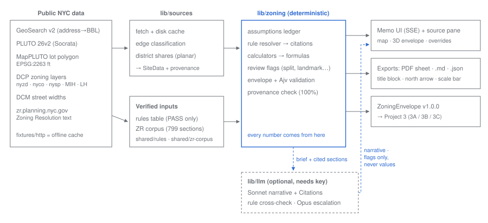

# Site Brief: cited zoning analysis from an NYC address

Enter an NYC address or BBL and get a **draft** zoning memo. It includes lot data, districts, permitted use groups,
bulk rules, calculations with visible formulas, an assumptions ledger, review flags, a 3D envelope preview and a
`ZoningEnvelope` JSON for Project 3. Every number traces to a dataset field or a Zoning Resolution passage.

> Draft research for a licensed professional to review. Not a zoning determination.

## Setup (offline demo, 4 commands)
```bash
npm install
npm run build
SOURCE_MODE=offline npm start          # http://localhost:3000, uses recorded responses in fixtures/http
npm run eval                           # field accuracy + provenance report → evals/report.md
```
For live data, drop `SOURCE_MODE` (the default is `cache-first`). For the cited narrative and model cross-check, copy
`.env.example` to `.env.local` and set `ANTHROPIC_API_KEY`. Without a key, every value and calculation still works,
because none of them depend on the model.

Other scripts: `npm run dev`, `npm test` (Vitest), `npm run e2e` (Playwright, which includes axe accessibility scans),
`npm run typecheck`, `npm run lint`.

## Architecture


- **lib/sources** fetches and caches the public datasets: GeoSearch v2, PLUTO 26v2 (Socrata `64uk-42ks`), MapPLUTO polygons
  in EPSG:2263, DCP zoning layers and DCM street widths. It records dataset, version, field and fetch time for every value.
- **lib/zoning** is deterministic. It resolves rules from `lib/zoning/rules/*.json`, which is synced from `../../shared/rules`
  and built only from verifier-PASS research claims. Each rule carries the ZR section, a verbatim quote and the
  last-amended date. Calculators compute ZFA, coverage, setback planes and SEP planes, and show the formula. Assumptions
  (lot type, street width, building type, program, site category) are proposed from data, and the user can override
  them. The engine raises flags for split lots, landmarks, historic and special districts, data conflicts and unsupported
  districts. It builds the envelope and validates it with Ajv against `schemas/zoning-envelope.schema.json`, the
  canonical copy in `../../_Shared/schemas`.
- **lib/zr** is the ingested Zoning Resolution (799 sections from zr.planning.nyc.gov). It drives the source pane
  (it highlights the cited row or span), the use-group matrix from the official use tables, and BM25 search.
- **lib/llm** is optional. Sonnet writes a 120–220-word narrative using the Citations API over the cited sections, and
  each citation is checked against the source. An agent cross-checks the engine's rule selection, with Opus escalation
  on split lots or disagreements. It can only add flags or mark a field *Conflicting*. It never changes a value.
- **lib/export** produces the PDF drawing sheet (title block, north arrow, graphic scale, DRAFT stamp, Z-101…), Markdown and JSON.

## What is verified, and how
- Research notes are in `../research/`, and each claim carries a verbatim quote that was independently re-fetched by a
  verifier agent. The rules table has its own verification log in `../../shared/rules/VERIFICATION.md`.
- `npm run eval` compares 10 real parcels against gold values that the manager hand-wrote from verified sources
  (`evals/gold.json`). The last run: **88/88 fields, 0 hallucinated values, provenance 100%, 10/10 envelopes valid.**

## Known limitations
- **Districts.** The rule set covers R5, R6, R6A, R6B, R7A and R8A; C1/C2 overlays within them; C4-4A; and M1-1/M1-2. Other
  districts show *Needs input*.
- **Not modelled.** Special-district modifications, eligible sites (§23-434), shallow-lot provisions, the story limits in
  §23-736/§43-43, corner-lot rear yards and split-lot height/setback (§77-28) are flagged as manual.
- **Street width.** Wide/narrow comes from DCP DCM `Streetwidth`, which DCP labels as informational. It is only a
  *proposed* assumption, and R6 results depend on it.
- **District geometry.** DCP zoning layers aren't for lot-level determination. PLUTO decides the districts, and the
  layers only raise data-conflict flags.
- **Geometry.** 3D and PDF geometry are SIMPLIFIED. Street setbacks are drawn at the max base height and the SEP is
  drawn as one plane per frontage.
- **Untested without a key.** The live LLM paths are untested here because no API key was available. The unit tests
  use a mocked client.

## Cost notes
| Model | Input $/MTok | Output $/MTok |
|---|---|---|
| Sonnet 5.5 (`claude-sonnet-5-5`) | 2.00 | 10.00 |
| Opus 5.5 (`claude-opus-5-5`) | 4.00 | 20.00 |
| Haiku 5.5 (`claude-haiku-5-5`) | 0.10 | 0.50 |

These are list prices as of 2026-10-06, from the claude-api skill. Opus runs only for escalation. The ZR section
documents are prompt-cached, and the dev drawer shows the cost per request. Haiku's cache-read price isn't stated in
that source, so the cost shown for Haiku is a lower bound.
